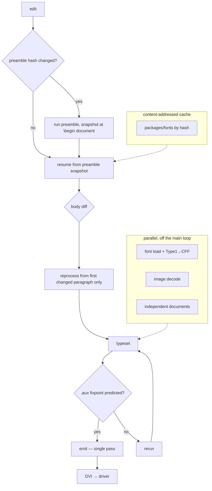
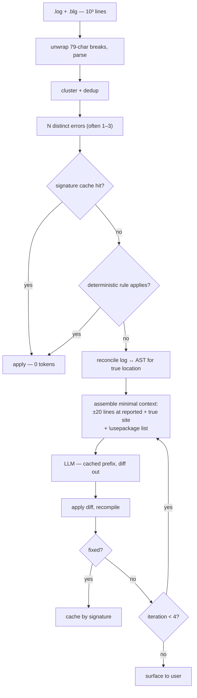

# aiTeX — Project Plan

> This file preserves the original product and architecture plan. Current
> performance, AI benchmark, product, and compatibility work is tracked in
> [`ROADMAP.md`](../../ROADMAP.md).

AI-mediated fast LaTeX compilation. Two halves: **(1)** a pure-Rust LaTeX engine, **(2)** an LLM
harness that repairs compilation failures with minimal token use. **`MIT OR Apache-2.0`** (the Rust
ecosystem convention — Apache adds a patent grant, MIT stays available), `tertius-ai/aiTeX`.

**Build strategy: minimum working example first, bells and whistles later.** The constraint is that
adding the whistles must not require a refactor — so the decisions in §1 are settled up front, and
everything else is deferred behind a seam.

---

## 1. Decisions that must be right up front

These are expensive or impossible to retrofit. Everything else can wait.

| # | Decision | Why now |
|---|---|---|
| 1 | **`World` trait for all I/O** — no direct `std::fs`/network in the engine | The only thing that keeps wasm32 and on-demand font/package fetch reachable. Retrofitting means touching every call site. |
| 2 | **Nodes as real Rust types**, not Knuth's flat `mem[]` word array | `rtex` did this and still passed TRIP. Reversing it means rewriting every node consumer. |
| 3 | **DVI-first; PDF lives in a separate driver crate** | Makes `hyperref`/`graphicx` *driver* work via `\special` instead of engine work, and DVI is the differential-test oracle. |
| 4 | **Line breaker behind a trait** | Lets a naive greedy breaker ship first and Knuth-Plass drop in later untouched. |
| 5 | **Font access behind a trait** | Lets TFM-only ship first and OpenType/shaping arrive later without engine changes. |
| 6 | **`aitex-core` owns the diagnostic model** | The harness must describe an error identically from our engine or a scraped `pdflatex` log. Shared vocabulary can't be bolted on. |
| 7 | **Corpus records ground truth + localization gap** | Regenerating a labeled corpus later is expensive; the gap metric is the headline result. |
| 8 | **`aitex-engine` deps limited to `serde` + `postcard`; heavier deps quarantined in `aitex-fonts`** | Near-zero by design. The two exceptions power engine-state dump/restore — core product machinery (preamble snapshot, incremental re-typesetting), pure Rust, no_std, wasm-clean, permissive. `cargo-deny` + `tools/check_zero_deps.py` enforce the allowlist from commit 1. |
| 9 | **Hand-written tokenizer; `rowan` tree for the harness. No parser generator.** | TeX is not context-free — `\catcode` mutates at runtime, so expansion can redefine the tokenizer. And the harness parses *broken* input, where generated parsers recover badly. |

**Dependency policy.** Near-zero: the engine's only runtime deps are `serde` + `postcard` (state
dump/restore). Each exception needs explicit sign-off and must be pure Rust, wasm32-clean, and
permissively licensed (MIT/Apache/BSD) — **LGPL, GPL, and AGPL are all excluded** now that we ship
permissively. serde + postcard were signed off deliberately (2026-07, wasm32 build verified) because
serialization is core product machinery, not a niche add-on, so a feature gate would have been
always-on friction. **`dev-dependencies` are exempt**: they don't ship in the binary, so test and
fuzz tooling is unrestricted.

---

## 2. Layout

```
aiTeX/
├── crates/
│   ├── aitex-core/      # source spans, diagnostic model, error taxonomy
│   ├── aitex-engine/    # COMPONENT 1 — the TeX engine.  serde + postcard only.
│   ├── aitex-harness/   # COMPONENT 2 — the repair harness. Normal deps.
│   └── aitex-cli/       # the `aitex` binary — the only driver
└── corpus/              # git-ignored
```

`aitex-fonts`, `aitex-driver` and `aitex-corpus` were reserved as one-line
placeholders and removed in 2026-08; TFM lives in the engine, and the DVI→PDF
and corpus-runner crates can be created when there is code for them.

---

## 3. Engine approach

Port `tex.web` (~25k lines of literate Pascal, frozen 1990 — the same code `pdflatex` runs after
`tangle` → `web2c`). Feasibility is settled: [`rtex`](https://github.com/tyti/rtex) is a complete
TeX82 in pure Rust that passes TRIP, done solo in ~3 weeks by module-by-module translation, zero
deps. Scope: ~25–30k lines.

> **Do not read rtex's source.** It is GPL-3.0 and we ship permissively, so exposure compromises the
> clean-room position. Tiessen's [TUG 2024 talk](https://www.youtube.com/watch?v=8za5NdavSpU) is a
> public description of *method* and is fine; so are factual observations (it passes TRIP, module
> sizes, ~3 weeks). Our spec is `tex.web` itself.

- **Port from `tex.p`** (tangled Pascal) with `tex.web` as spec — **not** from web2c's C output,
  where Tectonic's `c2rust` attempt died on platform plumbing.
- **Compatibility comes free from fidelity.** LaTeX packages are pure TeX macros, so a faithful
  engine runs `latex.ltx`, `amsmath`, and TikZ with no special effort.

---

## 4. Engine milestones

**E1–E4 are done (2026-08).** The engine loads `latex.ltx`, sets a
`\documentclass{article}` document byte-identically to pdfTeX over hundreds of
pages, and agrees with `tex -ini` on all 626 syntax-battery forms and all 27
`plain.tex` state probes. TRIP is not passed. What remains is fidelity gaps
found by widening the oracle (see `tools/`), and speed: ~2.4× `tex -ini`.

**E1 — walking skeleton.** `World` trait, tokenizer, catcodes, eqtb, macro expansion, primitives,
boxes/glue/modes, TFM, **greedy line breaker**, DVI out. Goal: `story.tex` → DVI comparable to `tex`.

**E2 — the actual hard part: page builder + `\output`.** Plus `\vsplit`, inserts, marks. This is the
genuine subtlety (not Knuth-Plass): `\output` is a TeX *macro* that runs mid-page-build and can
`\unvbox255` material back into the contribution list. Hit it early.

**E3 — Knuth-Plass.** Drop-in behind the E1 trait. ~1500 lines; `tex.web` §813–890 plus the 1981
paper is a complete spec.

**E4 — e-TeX primitives.** `\numexpr`, `\protected`, `\detokenize`, `\ifdefined`. Non-negotiable:
expl3 depends on them and has been part of the LaTeX format since 2020. Milestone: run `latex.ltx`.

**Test gradient** — iterate against the first three daily:

`story.tex` → `l3build` `.lvt`/`.tlg` → differential `dvitype` diff vs `pdftex -output-format=dvi` → **TRIP**

**On TRIP** (Knuth's torture test, `trip.tex` + reference `trip.log`/`tripin.log`/`trip.fot`/`trip.typ`):
it is a **late confidence check, not a gate** — XeTeX and LuaTeX don't pass it either, since LuaTeX
replaced `mem[]` outright. Two properties make it useful anyway:

- **It's gradeable.** Every artifact is a text file you diff, so "% of `trip.log` matching" is a real
  metric — and with `\tracingall` on, the diff localizes failures to specific operations.
- **`tripin.log` lands early.** The INITEX/format-dump phase validates tokenizer, eqtb, primitive
  tables, and dump/undump with **no typesetting at all** — a natural E1 checkpoint, well before
  `trip.log` is reachable.

Expect it to look bad for a long time and then jump: TRIP deliberately tortures the memory manager
with a 3000-word pool, and decision 2 (real Rust types, not flat `mem[]`) means our memory statistics
will differ by construction. `rtex` made the same choice and still passed. Their analogues **etrip**
(e-TeX) and **ptrip** (pdfTeX) apply once E4 and the pdfTeX primitives land; ptrip is markedly less
canonical.

---

## 5. Harness milestones

**H1 — deterministic core, no LLM.** Invoke with `max_print_line=1000 -file-line-error
-interaction=nonstopmode -no-shell-escape`; these flags matter more than the parser, since TeX wraps
log lines at 79 chars by default. Parse `.log` **and `.blg`** (bib errors never appear in `.log`),
emit `aitex-core` diagnostics.

**H2 — fix rules**, targeting 40–60% of errors at zero token cost: rerun pipeline (undefined
refs/citations are a *scheduling* bug — delegate to `latexmk`); clean aux; install missing `.sty` via
`tlmgr`; macro→package table (`\includegraphics`→`graphicx`); edit-distance ≤2 CS correction.

**H3 — LLM layer.** The measured lever: fix rates go **16–28% (log only) → 38–47% (log + snippet)**,
while worked examples buy nothing. Send ±20 lines around the error, skip exemplars, cap the loop at
3–4 iterations, ask for a diff not a file, cache by error signature. Hand-rolled `reqwest` + `serde`
against `/v1/messages` — no official Rust SDK, and community crates risk lagging on `cache_control`
placement, which the token strategy depends on.

**H4 — AST reconciliation.** Reconcile "where TeX says the error is" against "where the tree says the
brace is missing", via our own `rowan` grammar. Solves non-localized errors; the harness's core
value, but H1–H3 first.

---

## 6. Corpus

**Timing corpus (local, never leaves the machine)** — published papers from `~/Dropbox/research`
(1556 `.tex` files, 173 projects), identified via the arXiv API and matched to directories. Excludes
all grant/job/tenure/referee/letter material.

**Fix-rate corpus (arXiv, redistributable)** — ~200 papers via `arxiv.org/e-print/<id>`, IDs from the
free API, ~1 req/3s. (Not the requester-pays S3 bucket — that's for bulk extraction.) The 100 that
compile clean become the clean set; record golden PDF hash + page count.

**Spread across all of arXiv, not just math.** A few from each major section — physics, cs, q-bio,
econ, stat, eess, astro-ph, cond-mat — so the corpus exercises different document classes, journal
styles, and conventions rather than one community's habits. **Prefer simple preambles**: filter for
few `\usepackage` lines and no exotic dependencies. Two reasons — heavy TikZ/pgfplots documents
measure package execution rather than engine speed, and a minimal-dependency document is one our own
engine can plausibly compile early, making the corpus usable as an engine milestone and not only as
a harness benchmark.

**1000 broken** — mutate the clean set; record `(file, line, span, family, original_text)`; discard
mutants that still compile.

**Weighted toward non-localized errors** — where log-only parsing fails and AST reconciliation must
prove itself. The gap is *measurable*, so select for it rather than guess:

```
gap = |reported_line − true_line|        (∞ if reported in a different file)
```

Stratify ≈ ⅓ `gap=0`, ⅓ `0<gap≤50`, ⅓ `gap>50`, and **report every metric as a function of gap** —
an average hides exactly the behavior we care about. Largest gaps come from separating *definition*
from *use*, not unbalanced delimiters:

| Family | Gap |
|---|---|
| Change `\newcommand` arity; drop a `\usepackage`; rename a macro at its definition | **very large** |
| Delete `}` mid-environment; delete `\end{env}`; unclosed `$`; unbalanced brace in macro arg | large |
| Break tabular column count; recursive `\def` | medium |
| Misspell a CS; break an `\input` path | zero |
| Corrupt a `.bib` entry | different file (`.blg`) |

---

## 7. Architecture A — how we get fast

**Be honest about the source of the win.** A faithful `tex.web` port will initially be *slower* than
pdfTeX, which is 40 years of optimized C. Rust does not make typesetting faster, and TeX's main loop
is irreducibly sequential. **All real speed comes from not repeating work.**



| Lever | Expected win | Notes |
|---|---|---|
| Preamble snapshot / fork-at-`\begin{document}` | **~60%** of edit-loop latency | Preamble dominates short docs. Works with fontspec, unlike `.fmt` dumps. |
| Incremental body reprocessing | high, interactive | TeXpresso proves it's possible without reimplementing TeX |
| Rerun prediction from `.aux` diff | eliminates a full pass when it holds | Must be *conservative* — predict "converged" only when provably safe |
| Content-addressed package/font cache | medium | Also the wasm fetch story |
| Parallel font/image/independent docs | medium | The **only** sound parallelism |

**Not a lever: rayon over document chunks.** Unsound, for the decision-9 reason.

---

## 8. Architecture B — how we use tokens wisely

The design is a **funnel**: every stage must terminate as many errors as possible at zero token
cost, so the model sees only what genuinely needs judgment.



Each stage earns its place from measurement, not intuition:

| Stage | Effect |
|---|---|
| Cluster + dedup | one `Undefined control sequence` × 200 becomes **one** prompt line |
| Signature cache | repeat errors across a corpus cost **0 tokens** |
| Deterministic rules | target **40–60%** of all errors at **0 tokens** |
| Snippet not file | the big one: **16–28% → 38–47%** fix rate |
| Skip worked examples | 38–47% → 38–49% — **not worth the tokens** |
| Prompt caching | frozen rulebook first, volatile log last; cache reads ~0.1× |
| Diff not file | output cost scales with the fix, not the document |
| Cap at 4 iterations | benefits plateau after 3–4 |

**Tracked metric: tokens per fix**, as a function of localization gap.

---

## 9. Testing — properties and ablation

**Property tests** (`proptest`):

| Property | Statement |
|---|---|
| Determinism | same input → byte-identical DVI, always |
| DVI round-trip | write → parse → equals original node list |
| `scaled` arithmetic | fixed-point ops obey TeX's documented rounding, no overflow |
| Line breaking | Knuth-Plass total demerits ≤ greedy's on every input |
| Mutation validity | every retained mutant fails to compile; every discarded one compiles |
| Harness safety | applying a fix never *increases* the error count |
| Fix idempotence | re-running the harness on a fixed document is a no-op |

**Ablation** — the harness's headline result. Measure each component's marginal contribution by
removing it, reported as a function of localization gap:

```
log only  →  +fix rules  →  +snippet context  →  +AST reconciliation  →  full
```

This is what proves (or refutes) the claim that AST reconciliation is what solves non-localized
errors. If the AST layer doesn't move the `gap > 50` bucket, it isn't earning its complexity.

---

## 10. Baselines to beat

One-time table, both corpora, median of 3 runs, cold and warm cache:

- **Total compile time** — `latexmk` to convergence, and single-pass `pdflatex`.
- **Time to first error** — via `-halt-on-error`, on the broken corpus.

Both tracked as regressions thereafter, alongside **tokens per fix** (token minimization is a stated
must-have, so it needs a number, not an aspiration).

Baseline machine: TeX Live 2024, pdfTeX 1.40.26, 14 cores / 36 GB.

---

## 11. Deferred — and the seam that makes each cheap to add

| Deferred | Seam | Notes |
|---|---|---|
| Knuth-Plass | 4 | drop-in |
| OpenType + complex-script shaping | 5 | **don't write a shaper** (HarfBuzz ≈100k lines) — use `harfrust`. Needs sign-off. |
| Math (`mlist_to_hlist`) | — | largest single component; nothing depends on it |
| PDF output, Type1→CFF | 3 | Type1→CFF like xdvipdfmx, then `subsetter` + `pdf-writer`. `hayro-font` parses Type 1; converter is ours (dvipdfm-x as reference). **No OTF substitution** — `cmex`/`cmsy`/`cmmi` have no OTF at all. |
| pdfTeX font expansion + protrusion | — | what `microtype` compiles to; no `\special` substitute. **Couples to harness H2**, whose best badbox fix is adding microtype. |
| `hyperref`, `graphicx` | 3 | `\special` + driver |
| Speed work (preamble fork-and-resume, caching, rerun prediction) | — | behind a passing test suite. **Sound parallelism only** — TeX's main loop is irreducibly sequential. |
| WASM | 1 | |
| dvips / PSTricks / EPS | — | out of scope; EPS needs a PostScript interpreter |

**Not reusable — all copyleft, must be written:** RusTeX `tex_engine`, texlab, texlogsieve (all
GPL-3.0). Algorithms aren't copyrightable — read and reimplement. `rowan` itself is MIT/Apache.

---
